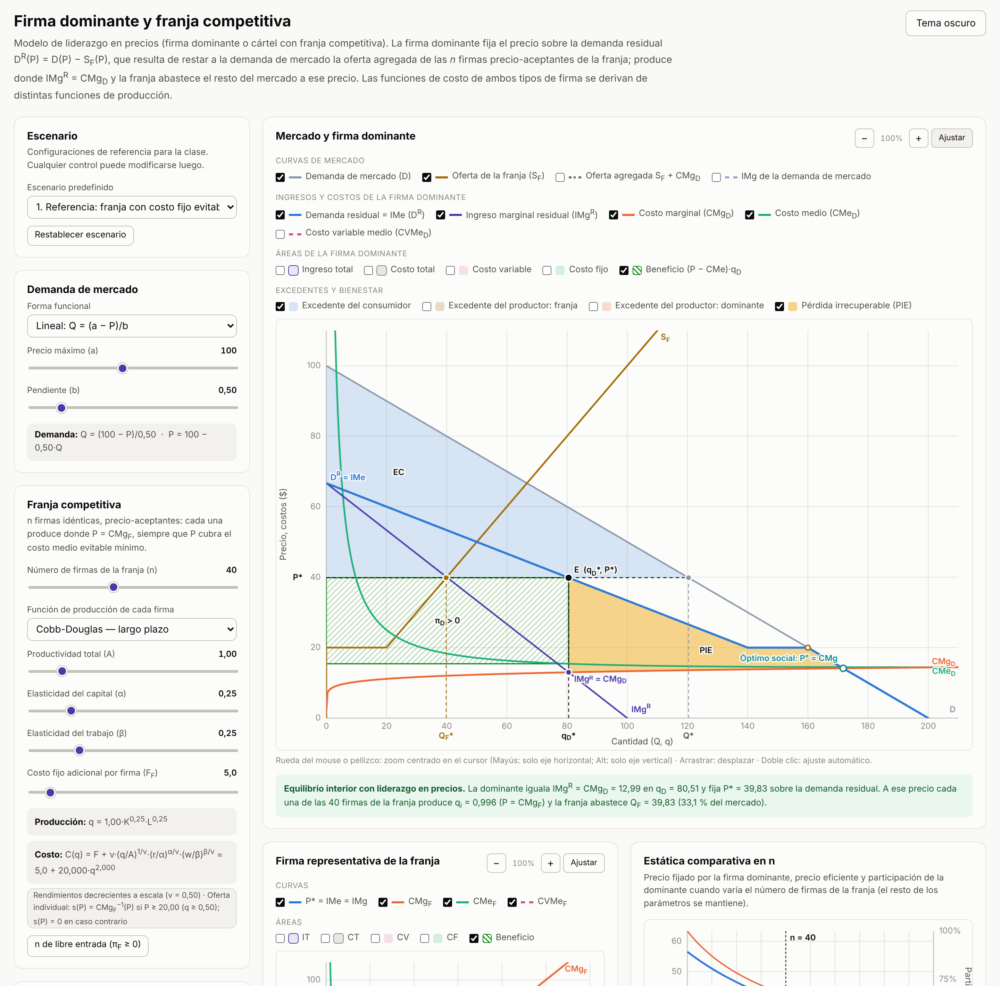
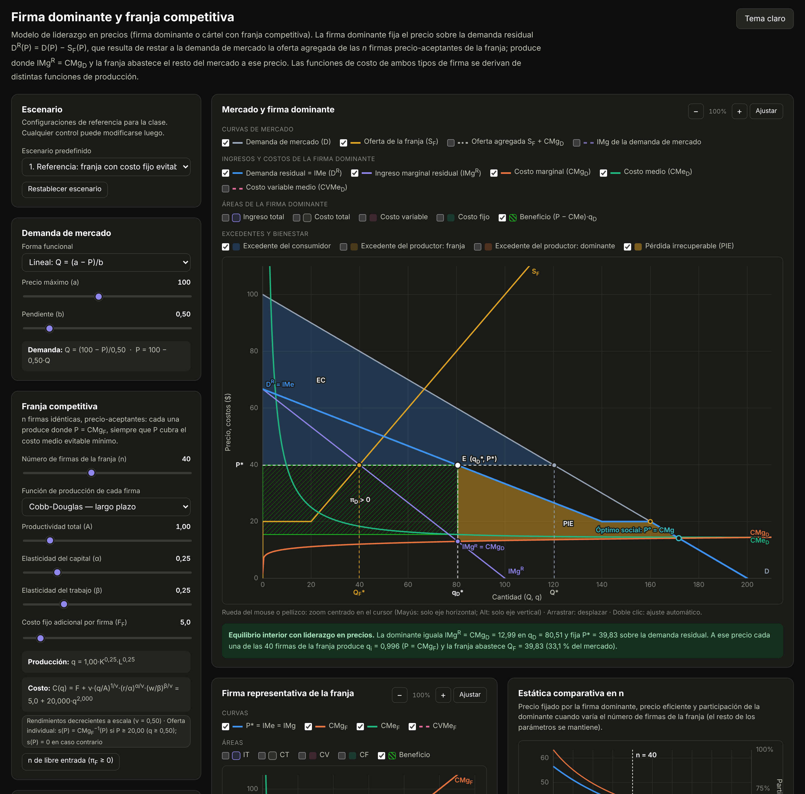

# Firma dominante y franja competitiva

Simulador interactivo, en un único archivo HTML autocontenido, del modelo de **liderazgo en precios** (firma dominante o cártel con franja competitiva). La firma dominante fija el precio sobre su demanda residual, que resulta de restar a la demanda de mercado la oferta agregada de *n* firmas pequeñas precio-aceptantes; la franja abastece el resto del mercado a ese precio. Las funciones de costo de ambos tipos de firma se derivan de distintas funciones de producción. Material didáctico para Microeconomía Intermedia (Bloque 3: Estructuras de mercado, Oligopolio).

**[▶ Abrir el simulador](https://fcontiggiani.github.io/firma-dominante/firma_dominante.html)**



<details>
<summary>Versión en tema oscuro</summary>



</details>

## Modelo económico

**Franja competitiva.** Cada una de las *n* firmas idénticas resuelve max P·q − C<sub>F</sub>(q) tomando P como dado. Con CMg<sub>F</sub> creciente, la oferta individual es s(P) = CMg<sub>F</sub><sup>−1</sup>(P) para P ≥ P̲, donde P̲ es el mínimo del costo medio evitable (CVMe en el corto plazo; (CV + F)/q en el largo plazo). La oferta agregada es S<sub>F</sub>(P) = n·s(P).

**Demanda residual.** La firma dominante enfrenta

```
Dᴿ(P) = D(P) − S_F(P),      dDᴿ/dP = D′(P) − S_F′(P) < 0
```

Para P < P̲ la franja no opera y Dᴿ coincide con la demanda de mercado; en P̲ la curva tiene un quiebre (con salto si la oferta individual comienza en q > 0), y se anula en el precio P̂ con D(P̂) = S_F(P̂).

**Problema de la firma dominante.**

```
max_P  π_D(P) = P·Dᴿ(P) − C_D(Dᴿ(P))
CPO:   IMgᴿ(q_D) = P + q_D / Dᴿ′(P) = CMg_D(q_D)
```

**Regla de precios.** Con |ε| = −D′·P/Q (valor absoluto de la elasticidad de la demanda de mercado), η<sub>F</sub> = S<sub>F</sub>′·P/Q<sub>F</sub> (elasticidad de la oferta de la franja) y s<sub>D</sub> = q<sub>D</sub>/Q:

```
(P − CMg_D)/P = s_D / (|ε| + η_F·(1 − s_D))
```

Con s<sub>D</sub> = 1 se recupera el índice de Lerner del monopolio (1/|ε|); con η<sub>F</sub> → ∞ el margen tiende a cero. El simulador verifica numéricamente la igualdad entre el Lerner observado y el que predice la fórmula.

**Asignación eficiente y pérdida irrecuperable.** Con la franja precio-aceptante, el excedente total como función de la producción de la dominante satisface dW/dq<sub>D</sub> = Pᴿ(q<sub>D</sub>) − CMg<sub>D</sub>(q<sub>D</sub>). Por lo tanto el óptimo iguala el precio con el costo marginal de todas las firmas y la PIE es el área entre la demanda residual y el CMg de la dominante:

```
PIE = ∫ de q_D* a q_Dᵒ de [Pᴿ(q) − CMg_D(q)] dq
```

**Medidas de bienestar.**

| Medida | Expresión |
|---|---|
| Excedente del consumidor | EC = ∫<sub>P*</sub><sup>∞</sup> D(p) dp |
| Excedente del productor, franja | EP<sub>F</sub> = ∫<sub>0</sub><sup>P*</sup> S<sub>F</sub>(p) dp (área a la izquierda de S<sub>F</sub>) |
| Excedente del productor, dominante | EP<sub>D</sub> = ∫<sub>0</sub><sup>q<sub>D</sub>*</sup> [P* − CMg<sub>D</sub>(q)] dq |
| Beneficio de la dominante | π<sub>D</sub> = (P* − CMe<sub>D</sub>)·q<sub>D</sub>* |
| Beneficio de cada firma de la franja | π<sub>i</sub> = (P* − CMe<sub>F</sub>)·q<sub>i</sub>* |

**Funciones de costo.** Las mismas seis tecnologías del simulador de monopolio, seleccionables por separado para la dominante y para la franja. Las versiones de largo plazo son funciones de costo duales de min wL + rK s.a. f(K, L) = q.

| Tecnología | Función de producción | Función de costo |
|---|---|---|
| Cobb-Douglas (LP) | q = A·K^α·L^β, ν = α + β | C = F + ν·(q/A)^(1/ν)·(r/α)^(α/ν)·(w/β)^(β/ν) |
| Cobb-Douglas (CP) | q = A·K̄^α·L^β | C = r·K̄ + F + w·(q/(A·K̄^α))^(1/β) |
| CES (LP) | q = A·[α·K^ρ + (1−α)·L^ρ]^(ν/ρ), ρ = (σ−1)/σ | C = F + c(w,r)·(q/A)^(1/ν), c = [α^σ r^(1−σ) + (1−α)^σ w^(1−σ)]^(1/(1−σ)) |
| Leontief (LP) | q = mín(K/v_K, L/v_L) | C = F + (r·v_K + w·v_L)·q |
| Sustitutos perfectos (LP) | q = a_K·K + a_L·L | C = F + mín(r/a_K, w/a_L)·q |
| Cúbica (CP) | q = A·K̄^θ·(c₁L² − c₂L³), L ≤ L̄ = 2c₁/(3c₂) | C = r·K̄ + F + w·L(q), capacidad q̄ = q(L̄) |

Para la franja, los parámetros se acotan automáticamente a rendimientos no crecientes a escala (ν ≤ 1): con rendimientos crecientes una firma precio-aceptante no tiene un nivel de producción que maximice beneficios. Con la tecnología cúbica el umbral de cierre coincide con el máximo del producto medio del trabajo (L = c₁/(2c₂)), es decir, con la frontera entre las etapas I y II.

**Casos que se señalan explícitamente:**

- equilibrio interior (IMgᴿ = CMg<sub>D</sub>);
- **precio límite**: franja con CMg constante (Leontief o sustitutos perfectos), que vuelve horizontal la demanda residual en c<sub>F</sub>;
- **precio de exclusión en el quiebre**: cuando el salto de la oferta agregada de la franja en P̲ es grande, la dominante fija el precio en el umbral y abastece todo el mercado (por ejemplo, el escenario 4 al pasar de n = 8 a n = 10);
- franja inactiva (el precio óptimo de la dominante es inferior a P̲);
- cierre o salida de la firma dominante;
- pérdidas con continuidad operativa en el corto plazo;
- dominante con rendimientos crecientes a escala y necesidad de subsidio bajo tarificación a costo marginal.

Como π<sub>D</sub>(P) puede no ser cóncava (quiebres de la demanda residual, rendimientos crecientes), el óptimo se calcula por búsqueda global en una grilla de precios con refinamiento por sección áurea, incorporando como candidatos los precios de quiebre y de límite.

## Controles

| Control | Rango | Efecto |
|---|---|---|
| Escenario predefinido | 6 escenarios | Referencia (umbral de entrada), precio límite, franja Cobb-Douglas de corto plazo, franja cúbica, dominante con rendimientos crecientes, demanda isoelástica |
| Forma funcional de la demanda | Lineal / isoelástica | Q = (a − P)/b o Q = A·P^(−ε) |
| Parámetros de demanda (a, b / A, ε) | 20–200, 0,1–3 / 5–500 miles, 1,2–4 | Desplazan y rotan D, y con ella Dᴿ e IMgᴿ |
| Número de firmas de la franja (n) | 0–100 | Escala la oferta agregada S<sub>F</sub> y contrae la demanda residual; n = 0 reproduce el monopolio |
| Función de producción (franja y dominante, por separado) | 6 tecnologías | Cada tecnología conserva sus parámetros al alternar entre ellas |
| Parámetros tecnológicos (A, α, β, σ, ν, K̄, v, a, c₁, c₂, θ) | Según tecnología | Desplazan y rotan las curvas de costos |
| Costos fijos adicionales F<sub>F</sub>, F<sub>D</sub> | 0–60 / 0–2000 | Hundidos en el corto plazo; evitables en el largo plazo (determinan el umbral P̲ de la franja) |
| Salario w y costo del capital r | 1–30 | Precios de los factores, comunes a ambos tipos de firma |
| n de libre entrada | Botón | Fija el mayor n con el que cada firma de la franja opera con beneficio no negativo |
| Curvas del panel de mercado | D, S<sub>F</sub>, oferta agregada, IMg de mercado, Dᴿ = IMe, IMgᴿ, CMg<sub>D</sub>, CMe<sub>D</sub>, CVMe<sub>D</sub> | Muestran u ocultan cada curva |
| Áreas del panel de mercado | IT, CT, CV, CF, beneficio, EC, EP de la franja, EP de la dominante, PIE | Muestran u ocultan cada área sombreada |
| Panel de la firma representativa de la franja | P* = IMe = IMg, CMg<sub>F</sub>, CMe<sub>F</sub>, CVMe<sub>F</sub>; IT, CT, CV, CF, beneficio | Decisión individual de la firma precio-aceptante y umbral de cierre |
| Zoom y desplazamiento (dos paneles) | Rueda, pellizco, arrastre, botones −/+ | Zoom centrado en el cursor; Mayús: solo eje horizontal; Alt: solo eje vertical; doble clic o «Ajustar» restablece la vista |
| Tema claro/oscuro | Botón superior | Por defecto sigue la preferencia del sistema; la elección se recuerda |

**Paneles de resultados.** P*, Q*, q<sub>D</sub>*, Q<sub>F</sub>*, q<sub>i</sub>*, participación s<sub>D</sub>, IMgᴿ y CMg<sub>D</sub> en el óptimo, CMe<sub>D</sub>, IT y CT de la dominante, π<sub>D</sub>, π<sub>i</sub>, Π<sub>F</sub>, EC, EP<sub>F</sub>, EP<sub>D</sub>, excedente total, PIE, |ε|, η<sub>F</sub> e índice de Lerner (observado y por fórmula). Una tabla compara tres asignaciones (dominante con franja, monopolio puro con n = 0 y asignación eficiente), un gráfico de **estática comparativa** muestra P*(n), el precio eficiente y s<sub>D</sub>(n) para n = 0, …, 100, y una sección plegable desarrolla la derivación analítica con los valores vigentes.

## Sugerencias de uso en clase

1. **Escenario 1, variar n de 0 a 100.** Con n = 0 la dominante es un monopolista; al aumentar n la demanda residual se contrae y se vuelve más elástica, el precio cae y la PIE se reduce. Contrastar el Lerner observado con s<sub>D</sub>/(|ε| + η<sub>F</sub>(1 − s<sub>D</sub>)).
2. **Escenario 2 (precio límite).** Con CMg<sub>F</sub> constante, la amenaza de la franja fija un techo al precio. Pedir que expliquen por qué la PIE es menor que en el monopolio puro aunque la franja no produzca.
3. **Escenario 4 (franja cúbica).** Llevar n de 8 a 10 y observar el cambio de régimen: de acomodar a la franja a excluirla con un precio en el umbral P̲.
4. **Libre entrada.** En el escenario 1 o 3, pulsar «n de libre entrada» e interpretar el equilibrio de largo plazo de la franja (π<sub>i</sub> ≈ 0) y su efecto sobre el poder de mercado de la dominante.

## Requisitos técnicos

- Archivo único `firma_dominante.html` (HTML, CSS y JavaScript inline), sin bibliotecas externas ni CDN. Los gráficos usan Canvas 2D nativo.
- Funciona en cualquier navegador moderno con JavaScript habilitado, sin conexión una vez descargado.
- La preferencia de tema se guarda en `localStorage`, protegido con `try/catch` para entornos con restricciones (iframes de Moodle).
- Diseño adaptable: en pantallas angostas los controles se apilan sobre los gráficos.
- El motor matemático (bloque `MATH-START`/`MATH-END`) fue validado en Node.js: dualidad de costos frente a minimización numérica, CMg analítico frente a numérico, oferta individual (P = CMg y maximización de beneficio), CPO IMgᴿ = CMg<sub>D</sub>, regla de Lerner, optimalidad global frente a una grilla de 200 000 precios, PIE como integral sobre la demanda residual, precio límite y libre entrada.

## Referencias

- Pindyck, R. y Rubinfeld, D. *Microeconomía*, cap. 12 (modelo de la empresa dominante y cárteles).
- Varian, H. *Microeconomía intermedia*, cap. sobre oligopolio (liderazgo en precios).
- Carlton, D. y Perloff, J. *Modern Industrial Organization*, cap. sobre firma dominante y franja competitiva.

## Licencia y uso

Material desarrollado con fines exclusivamente didácticos. Los valores numéricos son ilustrativos. Se autoriza su uso, adaptación y redistribución con fines educativos, citando la fuente.
